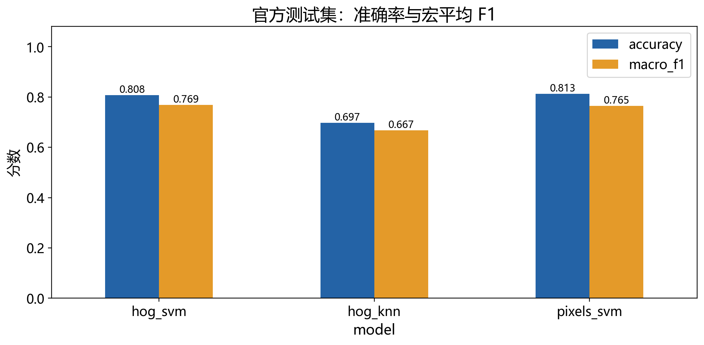

# 基于 HOG 特征与 SVM 的交通标志识别及鲁棒性分析

研究生《机器学习与 Python 实践》翻转课堂项目。输入一张已经裁剪好的交通标志图片，输出原始类别 ID 和中文名称。暂不制作 PPT、讲稿或图形界面。

已上传源代码、已训练模型、实验原始 CSV 和最终素材。原始 GTSRB 数据集与特征缓存不放入 Git；可按下文重新下载并运行。加载现有模型演示不需要重新训练。



[完整汇报素材索引](presentation_assets/full/汇报素材索引.md) · [实验结果分析](presentation_assets/full/结果分析.md) · [已训练模型](outputs/full/models)

## 环境与入口

已检测本机 `F:\Anaconda3\python.exe` 为 Python 3.12.7，具有所需科学计算库；项目不会修改全局环境。依赖精确版本见 requirements.txt。如在另一台机器，建议 Python 3.12 的独立环境：

```powershell
python -m venv .venv
.\.venv\Scripts\python.exe -m pip install -r requirements.txt
```

在项目根目录运行：

```powershell
$python = 'F:\Anaconda3\python.exe'
$env:PYTHONIOENCODING = 'utf-8'
[Console]::OutputEncoding = [System.Text.UTF8Encoding]::new($false)
& $python scripts/download_data.py
& $python main.py all --quick
& $python main.py all
```

一键入口：`powershell -ExecutionPolicy Bypass -File .\run_basic.ps1`；43 类加 `-Full`。快速实验选原始 ID 0–9，包含较多相似限速标志，属于方便跑通的固定子任务，不能代替43类结果。

## 数据来源及划分

使用发布者的 [GTSRB 说明](https://github.com/houbensebastian/GermanTrafficSignBenchmarks) 和 [官方 ERDA 存档](https://sid.erda.dk/public/archives/daaeac0d7ce1152aea9b61d9f1e19370/published-archive.html)。数据为 PPM，标注为分号分隔 CSV。下载三个文件：

- [GTSRB_Final_Training_Images.zip](https://sid.erda.dk/public/archives/daaeac0d7ce1152aea9b61d9f1e19370/GTSRB_Final_Training_Images.zip)
- [GTSRB_Final_Test_Images.zip](https://sid.erda.dk/public/archives/daaeac0d7ce1152aea9b61d9f1e19370/GTSRB_Final_Test_Images.zip)
- [GTSRB_Final_Test_GT.zip](https://sid.erda.dk/public/archives/daaeac0d7ce1152aea9b61d9f1e19370/GTSRB_Final_Test_GT.zip)

网络受限时手动将三个 ZIP 放在 `data/raw/`，再运行下载脚本检查和解压。下载、数据、模型和缓存不提交 Git。官方存档当前不直接提供摘要，因此本地 SHA256 用于运行追溯，文件大小和 ZIP CRC 用于完整性检查，不应声称本地哈希等于官方发布哈希。

训练集以类别 ID＋文件名首段轨迹 ID 分组，固定种子42，在每个类别内留约20%轨迹作验证。验证宏平均 F1 选择超参数后，使用训练＋验证重新拟合，最后评价完整官方测试集。不使用测试结果选参；不做数据增强。

本次完整数据审计发现8组官方训练/测试图片字节完全相同，训练侧均来自类别14的轨迹 `00014_00023`。项目保留全部12,630张官方测试图片，将匹配训练轨迹的全部30张图片记为 `excluded`，从拟合及验证池中隔离；完整训练池因此为39,179张。规则只依据图片内容重叠，不依据模型预测或测试指标；原始重复记录与隔离记录保留。它消除了发现的完全重复及其同轨迹帧，不能证明所有近似图片或物理标志关系均无重叠。10类子任务不包含类别14。

## 特征和公平比较

默认不追加 ROI，保证已经裁剪的新图片与训练输入一致。Pillow RGB→32×32双线性缩放→L灰度→除255。可配置 ROI 模式要求单图提供 `--roi X1 Y1 X2 Y2`，坐标包含右下边界。

HOG：方向9、cell 8×8、block 2×2、L2-Hys、transform_sqrt，特征324维。灰度像素1024维。所有模型在 Pipeline 内拟合 StandardScaler；拟合步骤仅见训练数据，最终重拟合才见 train＋val。

32×32 图像划为4×4个 cell；步长一个 cell 的2×2 block 共3×3个，每个 block 拼接4个 cell 的9方向直方图，最终得到3×3×4×9＝324维向量。HOG统计局部梯度方向，通常保留形状信息；灰度基线按行展开32×32像素。两者的实际效果以本次测试为准。

- HOG＋LinearSVC 与灰度＋LinearSVC 使用同一候选 C：0.01、0.1、1。
- HOG＋KNN 使用相同 HOG、欧氏距离、距离加权，候选邻居数3、5。
- 按验证宏 F1 选参；并列保留较小参数。
- 实际多分类 LinearSVC 采用一对其余（one-vs-rest），为各类别建立线性决策函数，预测取最高决策分数对应的原始类别 ID；分数不是概率。二维图只展示二分类边界、间隔与支持向量，用于解释原理。
- 拟合时间是最终模型拟合；选参时间另存。预测时间是已提特征到类别的整批时间，不含图像读取和特征提取。特征准备时间可能包含缓存读取，应结合缓存状态解释。单次耗时受硬件与负载影响。

本次硬件信息见各运行目录的 hardware.json；科学计算线程上限4，KNN任务数2。并行开发、特征准备和其他系统负载可能影响单次耗时，当前计时用于本项目同机参考，不是严格硬件性能基准。

配置见 configs/full.json。更改配置时请更改 output_dir 和 assets_dir，避免混合实验；缓存区分审计清单中的图片内容哈希、图片元数据、预处理、特征参数和数据顺序。外部自建清单如未提供哈希，只按文件元数据识别图片。

## 分步骤运行与离线演示

```powershell
& $python main.py prepare
& $python main.py train
& $python main.py evaluate
& $python main.py robustness
& $python main.py assets
& $python -m unittest discover -s tests -v
& $python scripts/verify_results.py --output outputs/full
& $python scripts/analyze_results.py --output outputs/full
```

`all` 顺序执行完整流程；`--quick` 可与各实验命令组合。加载本地模型和 `outputs/full/demo_inputs/` 中固定输入即可离线演示：

同一配置已成功 `prepare` 且图片未更改时，可以加 `--prepared` 复用审计和清单，避免反复解码全部图片，例如 `main.py all --prepared`。图片、标签或划分更改后应重新运行不带此参数的 `prepare`。默认命令每次执行完整数据检查。

```powershell
$sample = (Get-ChildItem outputs/full/demo_inputs/success_*.png | Select-Object -First 1).FullName
& $python main.py predict --image $sample --model outputs/full/models/hog_svm.joblib --output outputs/demo_success.png
$sample = (Get-ChildItem outputs/full/demo_inputs/failure_*.png | Select-Object -First 1).FullName
& $python main.py predict --image $sample --model outputs/full/models/hog_svm.joblib --output outputs/demo_failure.png
```

预测同时输出终端 JSON、中文标注 PNG 和 JSON 文件。SVM 决策分数不表示概率。

录制时也可执行 `powershell -ExecutionPolicy Bypass -File scripts/demo.ps1`，一次展示已固定的成功和失败输入；快速模型演示加 `-Run quick`。

## 结果位置与四人汇报素材

`outputs/quick/` 和 `outputs/full/` 分别保留模型、manifest、配置、环境及源码哈希、验证选参、逐图预测、各类指标、混淆计数、干扰子集和干扰预测。

`presentation_assets/quick/` 与 `presentation_assets/full/` 下按以下顺序保存：

1. `01_任务与数据/`：中文样例拼图、单类图、划分分布、预处理。
2. `02_特征提取/`：原图—灰度—HOG 三联图及独立图片。
3. `03_分类模型/`：明确标注为模拟数据的二维 SVM 图及原始坐标。
4. `04_实验分析/`：汇总表、三模型矩阵、局部混淆、案例、鲁棒性曲线与逐级干扰图片。

每套素材有 `汇报素材索引.md`，记录问题、条件、观察、结论边界和路径。统计图保存高清 PNG＋SVG，案例单图与组合图分别保存。案例按明确的类别与文件顺序选取，不能代替整体指标。

干扰实验固定模型、固定分层测试子集（每类最多30张）；亮度倍率1/0.75/0.5/0.25/0.1，模糊半径0/0.5/1/1.5/2原图像素；分别测试，均在缩放前处理。基线与不同强度使用同一批图片；小子集、数字干扰和德国标志数据都限制外推。

数据引用：J. Stallkamp, M. Schlipsing, J. Salmen, C. Igel, The German Traffic Sign Recognition Benchmark: A multi-class classification competition, IJCNN 2011；Man vs. Computer, Neural Networks 2012。

## 本次实际结果（2026-10-20）

正式43类采用31,349张训练、7,830张验证，选参后39,179张重训；完整官方测试12,630张。

|方法|准确率|宏平均F1|最终拟合/秒|整批预测/秒|
|---|---:|---:|---:|---:|
|HOG＋SVM，C=0.1|80.75%|0.7688|55.40|0.0792|
|HOG＋KNN，k=5|69.68%|0.6672|0.17|2.1921|
|灰度像素＋SVM，C=0.01|81.26%|0.7646|184.99|0.1520|

准确率与宏F1给出的排序不同；HOG宏F1优势很小，没有重复划分或显著性检验，不应称为全面提升。训练/预测时间不含特征准备和选参；灰度C=1的单次候选拟合耗时约845秒，且未胜出，全部记录保留。因此正式训练请预先完成，课堂演示直接加载模型。

固定1,290张鲁棒性子集：HOG＋SVM基线准确率76.98%；亮度0.1为61.71%，原图模糊半径2为44.57%。该子集与完整测试集的类别权重不同，不能直接拿两者准确率相减。

已通过8项回归测试、快速实验190项验收、正式实验198项验收。独立复核重新计算正式实验52个指标值，与CSV一致；三种模型的保存加载及单图检查一致，离线成功/失败演示已实际执行。详细记录为 outputs/evaluation_review.md 与各运行目录 delivery_verification.json。

最终素材入口为 presentation_assets/full/汇报素材索引.md，解释与局限见同目录结果分析.md。10类初步实验单独保留：灰度基线准确率87.75%，高于HOG＋SVM的76.50%，不能将其当作43类结论。当前未制作PPT、讲稿、操作视频或复杂界面；视频仅准备了可重复执行的命令与固定输入。
